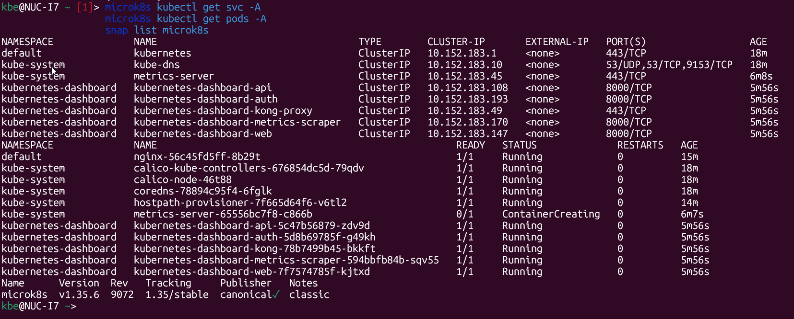
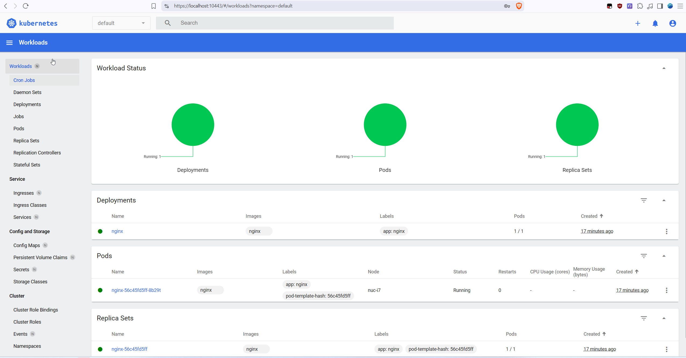

# Домашнее задание «Kubernetes. Причины появления. Команда kubectl»

[Условие домашнего задания](https://github.com/netology-code/kuber-homeworks_1.1_03.25/blob/main/README.md)

Среда: Windows → WSL → MicroK8s **v1.35.6**, канал `1.35/stable`. Dashboard открывается в браузере Windows. Если не указано иное, команды выполняются в Linux внутри WSL; использована оболочка fish.

Документ повторяет разделы и пункты домашнего задания. Выполненные действия подтверждены перепиской и приложенными скриншотами; непроверенные этапы отмечены отдельно.

| Пункт ДЗ | Состояние |
| --- | --- |
| 1.1. Установить MicroK8s | Выполнено в WSL |
| 1.2. Установить Dashboard | Выполнено |
| 1.3. Сгенерировать сертификат для внешнего IP | Инструкция подготовлена; выполнение не подтверждено |
| 2.1. Установить локальный kubectl | Выполнение не подтверждено |
| 2.2. Настроить локальное подключение к кластеру | Выполнение отдельным клиентом не подтверждено |
| 2.3. Подключиться к Dashboard через port-forward | Выполнено через microk8s kubectl в WSL |

## Задание 1. Установка MicroK8S

### 1. Установить MicroK8S на локальную машину или на удалённую виртуальную машину

MicroK8s установлен в WSL на локальном компьютере.

MicroK8s уже был установлен в WSL до настройки Dashboard. Для проверки готовности и версии:

```bash
microk8s status --wait-ready
microk8s kubectl get nodes
snap list microk8s
```

`status --wait-ready` ждёт готовности MicroK8s. `kubectl get nodes` показывает узлы Kubernetes; ожидаемый статус — `Ready`. `microk8s kubectl` запускает встроенный клиент с уже настроенным подключением к кластеру.

### 2. Установить dashboard

Дополнение включено, все компоненты Dashboard запущены.

```bash
microk8s enable dashboard
```

Команда включает дополнение с веб-интерфейсом Kubernetes. В нашем случае ответ был `Addon core/dashboard is already enabled`: дополнение уже включено.

Первоначальная команда из задания не сработала:

```bash
microk8s kubectl port-forward -n kube-system service/kubernetes-dashboard 10443:443
```

Причина ошибки `services "kubernetes-dashboard" not found`: в установленной версии у Dashboard другие пространство имён и сервис. Проверили реальные ресурсы:

```bash
microk8s kubectl get svc -A
microk8s kubectl get pods -A
```

`svc` — сервисы, предоставляющие доступ к приложениям; `pods` — поды с контейнерами; `-A` означает все пространства имён.

Обнаружили:

- пространство имён: `kubernetes-dashboard`;
- входной сервис: `kubernetes-dashboard-kong-proxy`, порт `443/TCP`;
- компоненты Dashboard: `api`, `auth`, `kong`, `metrics-scraper`, `web` — все в состоянии `1/1 Running`.



### 3. Сгенерировать сертификат для подключения к внешнему ip-адресу

**Этот этап обсуждён, но его выполнение пока не подтверждено.** Он нужен для пункта задания о подключении к Kubernetes API по внешнему для кластера адресу. Для подключения из Windows к WSL можно использовать доступный из Windows IP WSL.

1. Узнать IP WSL:

   ```bash
   ip -4 addr show eth0
   ```

   Взять адрес из строки `inet` без маски `/20` или другой длины префикса. Если `eth0` отсутствует, посмотреть интерфейсы через `ip -4 addr`.

2. Сделать резервную копию шаблона и открыть его:

   ```bash
   sudo cp -a /var/snap/microk8s/current/certs/csr.conf.template /var/snap/microk8s/current/certs/csr.conf.template.bak.(date +%Y%m%d-%H%M%S)
   sudo nano /var/snap/microk8s/current/certs/csr.conf.template
   ```

   Команда резервного копирования выше использует синтаксис **fish**. В разделе `[ alt_names ]` добавить `IP.N = <IP WSL>` перед `#MOREIPS`, где `N` — следующий свободный номер. Например, `IP.3 = 172.28.112.45`, если номер 3 свободен. Адрес в примере заменить своим; существующие записи сохранить.

3. Обновить сертификат API и дождаться готовности:

   ```bash
   sudo microk8s refresh-certs --cert server.crt
   microk8s status --wait-ready
   ```

   MicroK8s выпустит сертификат, подписанный своим центром сертификации, и перезапустит API server. В условии задания указан `front-proxy-client.crt`, но для адреса подключения клиентов нужен именно **`server.crt`**.

4. Проверить наличие своего IP в сертификате:

   ```bash
   sudo openssl x509 -in /var/snap/microk8s/current/certs/server.crt -noout -ext subjectAltName
   ```

   Ожидается запись `IP Address:` со своим адресом. В конфигурации внешнего `kubectl` этому адресу будет соответствовать `server: https://<IP WSL>:16443`.

Сертификат API на порту `16443` и HTTPS-сертификат Dashboard — разные сертификаты. Обновление `server.crt` не устраняет предупреждение браузера о сертификате Dashboard. При смене IP WSL адрес подключения и список адресов в сертификате нужно проверить заново.

## Задание 2. Установка и настройка локального kubectl

### 1. Установить на локальную машину kubectl

**Статус: выполнение не подтверждено.** До этого использовался встроенный клиент `microk8s kubectl` в WSL. Установка отдельного клиента пока не проверялась.

Для выбранной схемы следующий шаг — установить `kubectl` в Windows, чтобы обращаться к кластеру из Windows напрямую. Версию клиента следует выбирать совместимой с Kubernetes 1.35; клиент 1.35.x подходит. После установки проверить в PowerShell:

```powershell
kubectl version --client
```

**Ожидаемый результат:** команда показывает версию отдельного клиента. Фактический вывод нужно добавить после выполнения.

### 2. Настроить локально подключение к кластеру

**Статус: выполнение не подтверждено.** Подключение встроенного `microk8s kubectl` уже работает; подключение отдельного клиента Windows ещё нужно настроить.

Порядок настройки:

1. В WSL получить конфигурацию командой `microk8s config`.
2. Перенести конфигурацию в Windows в файл `%USERPROFILE%\.kube\config`. Если там уже есть настройки других кластеров, сохранить их и объединить конфигурации.
3. В поле `server` указать `https://<IP WSL>:16443`, используя адрес из пункта 1.3. Сохранить данные центра сертификации и учётные данные из исходной конфигурации.
4. Убедиться, что этот адрес доступен из Windows и входит в сертификат API, затем проверить подключение в PowerShell:

```powershell
kubectl get nodes
```

**Ожидаемый результат:** узел кластера со статусом `Ready`. Здесь после выполнения нужно добавить скриншот вывода этой команды — он требуется правилами приёма ДЗ.

Конфигурация `microk8s config` содержит учётные данные. Сам файл конфигурации и его содержимое не нужно публиковать в репозитории.

### 3. Подключиться к дашборду с помощью port-forward

**Статус: выполнено через встроенный клиент в WSL.** Dashboard открыт в браузере Windows. После настройки отдельного клиента в пункте 2.2 проброс можно повторить из PowerShell командой:

```powershell
kubectl port-forward -n kubernetes-dashboard service/kubernetes-dashboard-kong-proxy 10443:443
```

Одновременно запускать два проброса на локальный порт `10443` не нужно: сначала остановить старый сочетанием `Ctrl+C`.

#### Подготовка учётной записи для входа

Для входа была предложена отдельная учётная запись `dashboard-admin`. Ниже команды для воспроизведения этой настройки, если учётная запись ещё не создана:

```bash
microk8s kubectl -n kube-system create serviceaccount dashboard-admin
microk8s kubectl create clusterrolebinding dashboard-admin --clusterrole=cluster-admin --serviceaccount=kube-system:dashboard-admin
```

Первая команда создаёт служебную учётную запись. Вторая связывает её с ролью `cluster-admin`, дающей полные права на учебный кластер. Повторно создавать существующие объекты не требуется: ответ `AlreadyExists` означает, что они уже есть.

Получение временного токена:

```bash
microk8s kubectl -n kube-system create token dashboard-admin --duration=1h
```

Токен используется для входа в Dashboard. Запрашиваемый срок действия — один час; после истечения нужно получить новый токен той же командой. Токен нельзя публиковать в репозитории или на скриншотах.

Учётная запись находится в `kube-system`, а Dashboard — в `kubernetes-dashboard`. Это допустимо: права на кластер задаёт `ClusterRoleBinding`.

#### Выполненное подключение из WSL

Использовали сервис, найденный в пункте 1.2:

```bash
microk8s kubectl port-forward -n kubernetes-dashboard service/kubernetes-dashboard-kong-proxy 10443:443
```

Что означает команда:

- `-n kubernetes-dashboard` — искать сервис в этом пространстве имён;
- `service/kubernetes-dashboard-kong-proxy` — выбрать входной сервис Dashboard;
- `10443:443` — направить подключения к локальному порту `10443` на порт `443` сервиса. Kubernetes выбирает под за этим сервисом для проброса.

В браузере Windows открыли [https://localhost:10443](https://localhost:10443) и вошли в Dashboard. Windows получает доступ к локальному порту WSL через `localhost`.

**Результат:** интерфейс открылся; в пространстве имён `default` видны Deployment `nginx`, его ReplicaSet и работающий Pod. Создание `nginx` в этой инструкции не рассматривается: приложение уже присутствовало в кластере.



Терминал с `port-forward` должен оставаться открытым. `Ctrl+C` останавливает проброс, но не удаляет Dashboard и приложения. Для следующего входа нужно снова запустить `port-forward` и при необходимости получить новый токен.

На момент диагностики отдельный `metrics-server` находился в `ContainerCreating`, а в Dashboard показатели CPU и памяти не отображались. Причину и дальнейшее состояние этого компонента пока не проверяли; открытию интерфейса это не помешало.

## Материалы для сдачи и оставшиеся действия

- [x] MicroK8s установлен в WSL.
- [x] Dashboard установлен; скриншот интерфейса приложен в пункте 2.3.
- [ ] Выполнить и подтвердить обновление сертификата API для IP WSL — пункт 1.3.
- [ ] Подтвердить установку отдельного локального `kubectl` — пункт 2.1.
- [ ] Настроить подключение отдельного клиента и добавить скриншот `kubectl get nodes` — пункт 2.2.
- [ ] После проверки всех пунктов опубликовать README и изображения в своём Git-репозитории и отправить ссылку на README.

Источники: [Dashboard в MicroK8s](https://microk8s.io/docs/addon-dashboard), [порты и сертификат Kubernetes API](https://microk8s.io/docs/ports).
