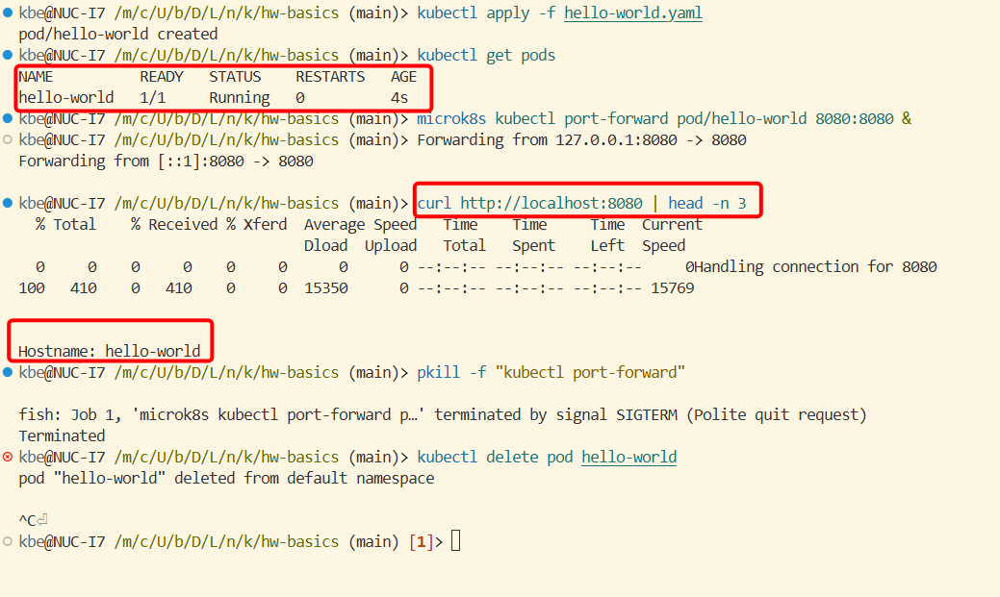
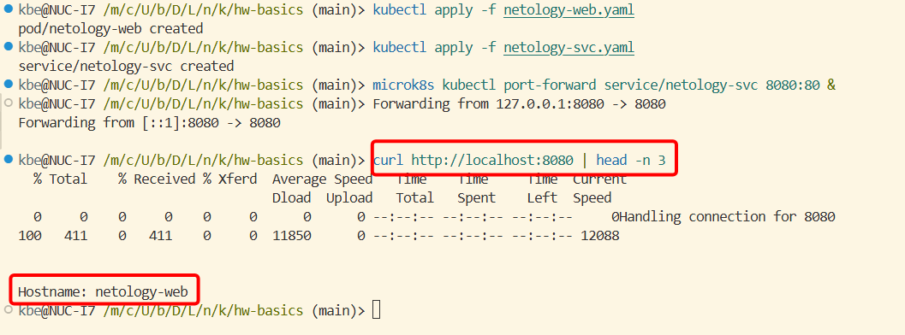

# Базовые объекты K8s

## Задание 1

- [Манифест создания pod](./hello-world.yaml)
- 

```shell
# deploy pod
kubectl apply -f hello-world.yaml

# статус работы pod
kubectl get pods

# port forward for pod
microk8s kubectl port-forward pod/hello-world 8080:8080 &

# show http reply
curl http://localhost:8080 | head -n 3

# stop port forwarding
pkill -f "kubectl port-forward"

# delete pod
kubectl delete pod hello-world
```

## Задание 2

- [Манифест создания сервиса](./netology-svc.yaml)
- 

```shell
# deploy pod
kubectl apply -f netology-web.yaml
kubectl get pods

# deploy service
kubectl apply -f netology-svc.yaml
kubectl get svc

# port forward for service
microk8s kubectl port-forward service/netology-svc 8080:80 &

# show http reply
curl http://localhost:8080 | head -n 3

# delete service
kubectl delete svc netology-svc

# delete pod
kubectl delete pod netology-web
```