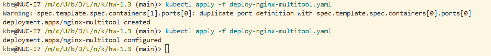
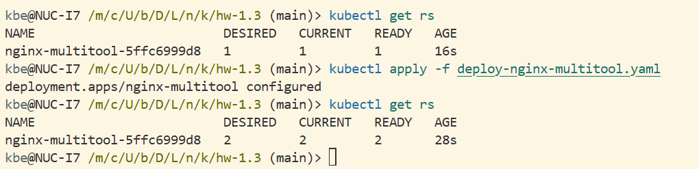
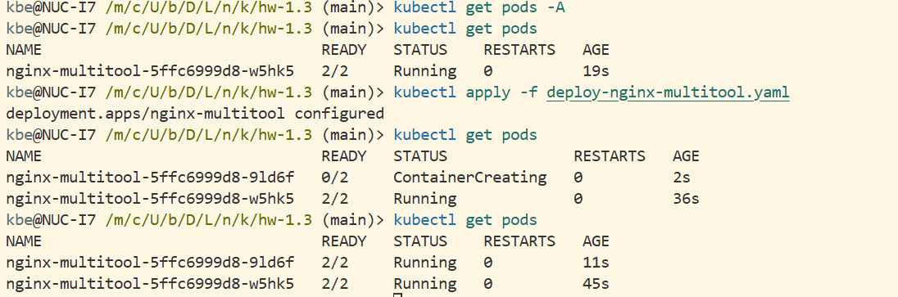
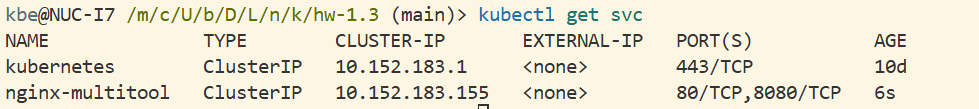
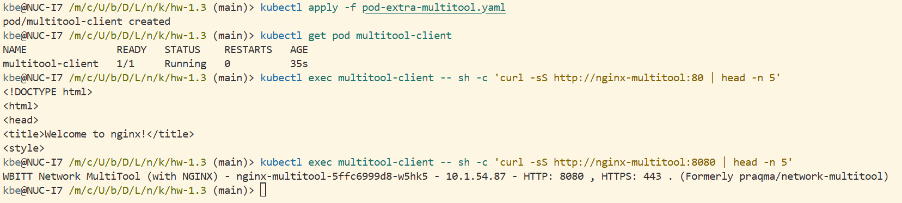
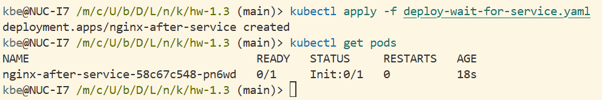
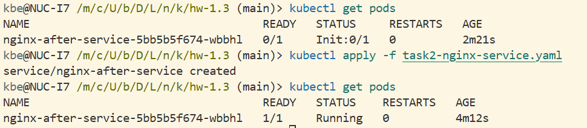

# Запуск приложений в Kubernetes

Выполнено задание по запуску многоконтейнерного приложения, масштабированию Deployment, публикации приложения через Service и запуску nginx после появления Service.

## Задание 1

- [Deployment nginx и multitool](./task1-deploy-nginx-multitool.yaml)
- [Service nginx и multitool](./task1-service-nginx-multitool.yaml)
- [Клиентский Pod multitool](./task1-pod-extra-multitool.yaml)

### 1.1. Deployment с nginx и multitool



Из-за проболемы нахлеста порта 80 между multitool и nginx созднf env-переменная `HTTP_PORT=8080` для multitool.


### 1.2. Масштабирование Deployment





Ad-hoc вариант масштабирования не применялся:

```bash
kubectl scale deployment/nginx-multitool --replicas=2
```

### 1.3. Service



Создан Service `nginx-multitool` с двумя портами:

```text
Service:80    -> Pod:80    -> nginx
Service:8080  -> Pod:8080  -> multitool
```

### 1.4. Проверка доступа из дополнительного multitool



## Задание 2

- [Deployment nginx с init-контейнером](./task2-deploy-wait-for-service.yaml)
- [Service для второго Deployment](./task2-nginx-after-service-start.yaml)

### 2.1. Deployment с ожиданием Service

Пока Init-контеинер не получит работающее разрешение DNS-имени Service,  nginx не запускается (с коротким именем проверка не сработало):

```sh
until nslookup nginx-after-service.default.svc.cluster.local.; do
  echo "Service is not available yet"
  sleep 5
done
```



### 2.2-3. Запуск Service и nginx



