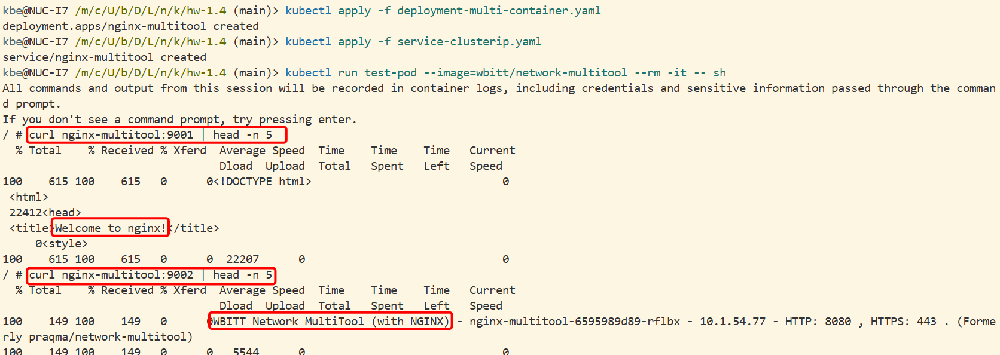
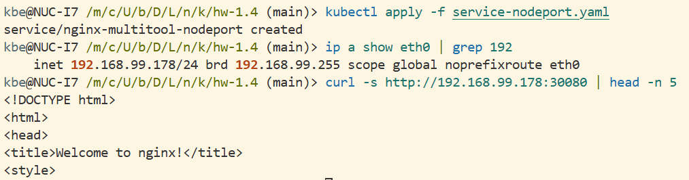
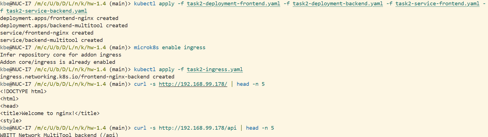

# Kubernetes: Service, NodePort и Ingress

## Задание 1. Сетевое взаимодействие

**Проверка доступа к nginx и multitool через ClusterIP**

**Проверка доступа к nginx через NodePort**

### 1.1. Deployment nginx и multitool

Манифест: [task1-deployment-multi-container.yaml](./task1-deployment-multi-container.yaml).

### 1.2. ClusterIP Service

Манифест: [task1-service-clusterip.yaml](./task1-service-clusterip.yaml).

### 1.3. Проверка доступа из Pod

Доступ к обоим приложениям проверен  `test-pod` с образом `wbitt/network-multitool`. Результаты проверки из временного pod на скриншоте.

### 1.4. NodePort

Манифест: [task1-service-nodeport.yaml](./task1-service-nodeport.yaml).

## Задание 2. Настройка Ingress

**Проверка маршрутов Ingress для frontend и backend**

### 2.1. Deployment frontend

Манифест: [task2-deployment-frontend.yaml](./task2-deployment-frontend.yaml).

### 2.2. Deployment backend

Манифест: [task2-deployment-backend.yaml](./task2-deployment-backend.yaml).

### 2.3. Services

- frontend: [task2-service-frontend.yaml](./task2-service-frontend.yaml);
- backend: [task2-service-backend.yaml](./task2-service-backend.yaml).

### 2.4. Ingress

- путь `/` направляется в Service `frontend-nginx`;
- путь `/api` направляется в Service `backend-multitool`.

Манифест: [task2-ingress.yaml](./task2-ingress.yaml).

### 2.5. Проверка доступности

Видно на  скрииншоте.

