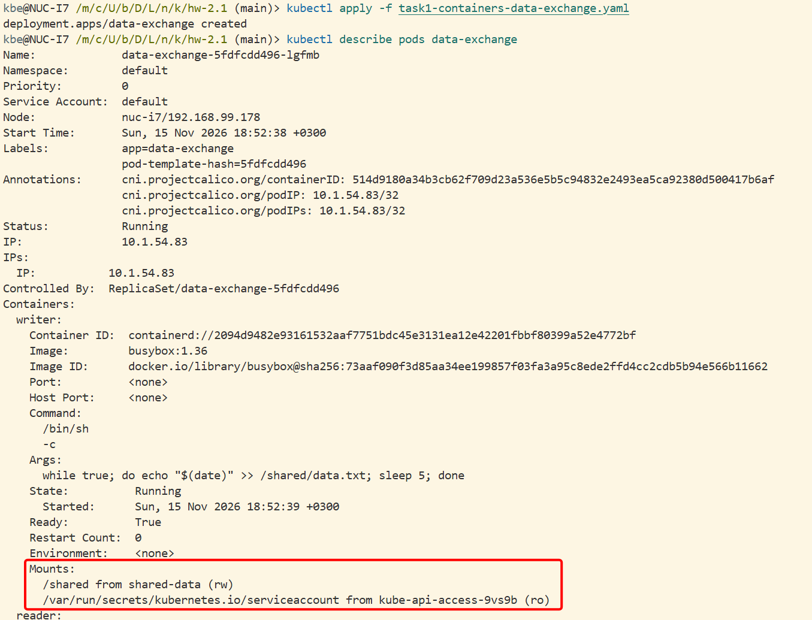
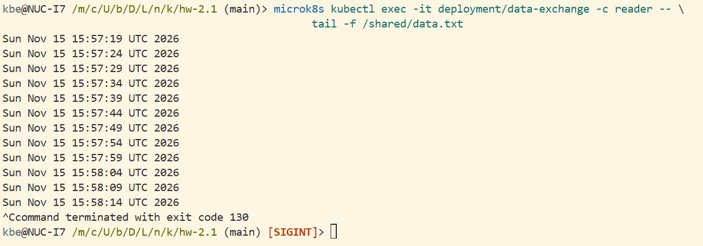
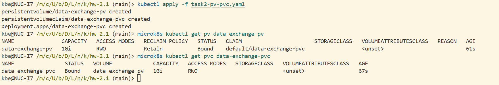
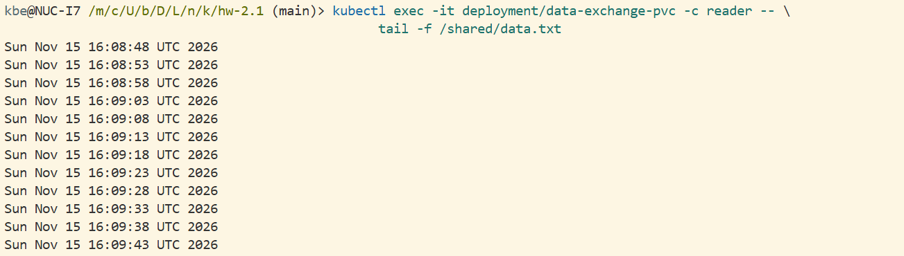
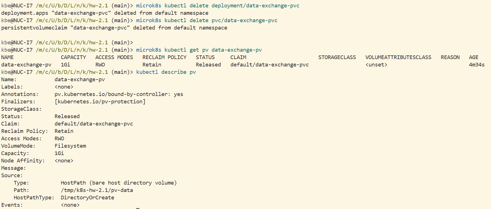
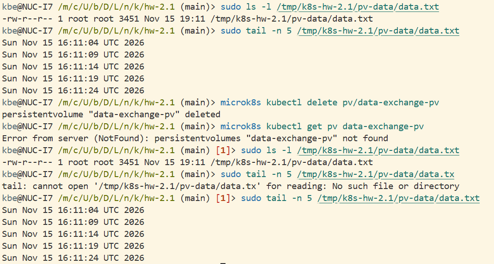
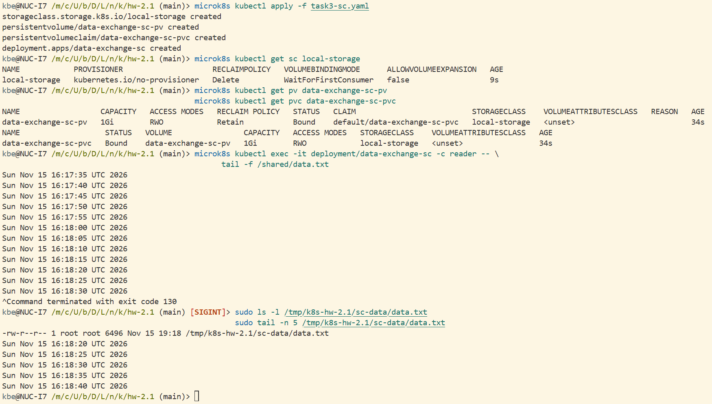

# Kubernetes: хранение данных

## Задание 1. Volume: обмен данными между контейнерами в поде

**Описание Pod и монтирование общего volume**

**Чтение общего файла из контейнера multitool**

### 1.1. Deployment с busybox и multitool

Манифест: [task1-containers-data-exchange.yaml](./task1-containers-data-exchange.yaml).

### 1.2. Запись данных в общую директорию

Общий volume создан как `emptyDir`.

### 1.3. Чтение файла контейнером multitool

Контейнер `multitool` читает файл из общей директории с помощью `tail -f`.

## Задание 2. PV, PVC

**Создание и привязка PV и PVC**

**Чтение файла из контейнера multitool через PVC**

**Состояние PV после удаления Deployment и PVC**

**Проверка файла до и после удаления PV**

### 2.1. Deployment с использованием PVC

Манифест: [task2-pv-pvc.yaml](./task2-pv-pvc.yaml).

### 2.2. PV и PVC для локальной директории

 каталог для ноды PV `/tmp/k8s-hw-2.1/pv-data` -подключается  через PVC.

### 2.3. Проверка обмена данными

`multitool` читает общий файл через PVC.

### 2.4. Состояние PV после удаления Deployment и PVC

После удаления PVC PV переходит в состояние `Released` и сохраняет ссылку на прежний claim. Политика `Retain` оставляет PV и данные для ручной обработки.

### 2.5. Сохранение файла после удаления PV

После удаления объекта PV файл остаётся в каталоге `hostPath` на ноде: удаление объекта не удаляет сам каталог и его содержимое.

## Задание 3. StorageClass

**StorageClass, привязка PVC и чтение файла**

Манифест: [task3-sc.yaml](./task3-sc.yaml).

