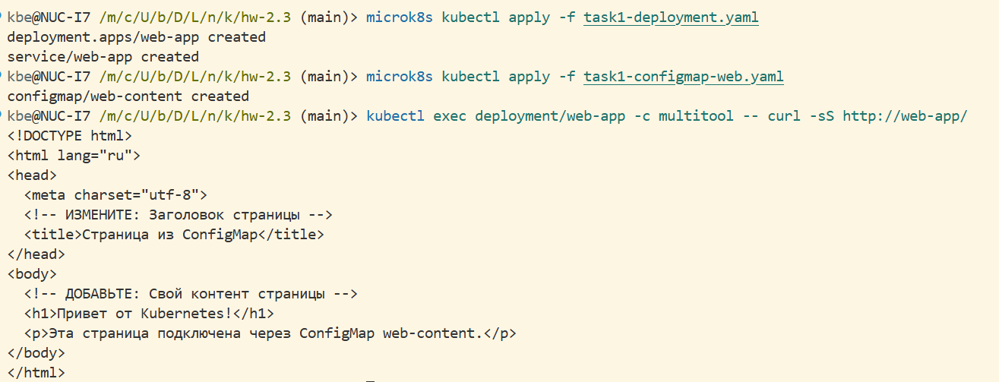
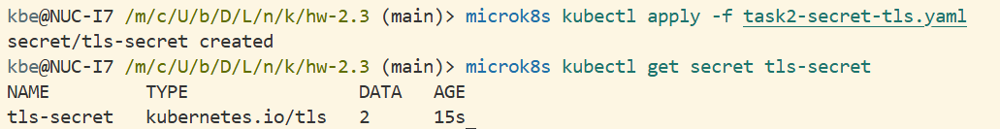
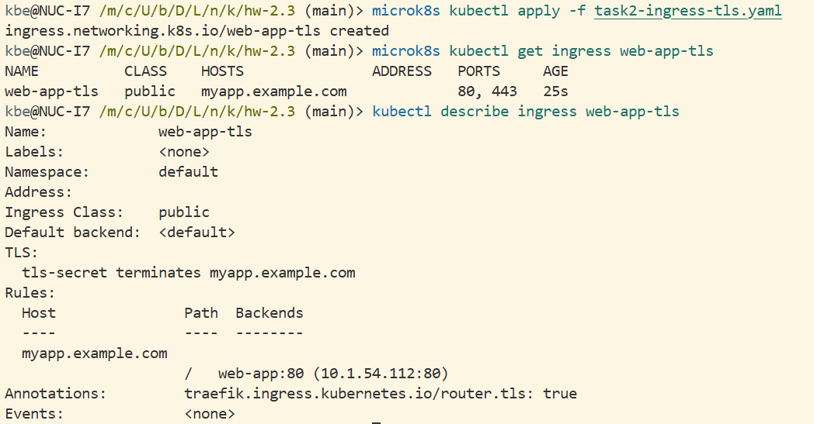
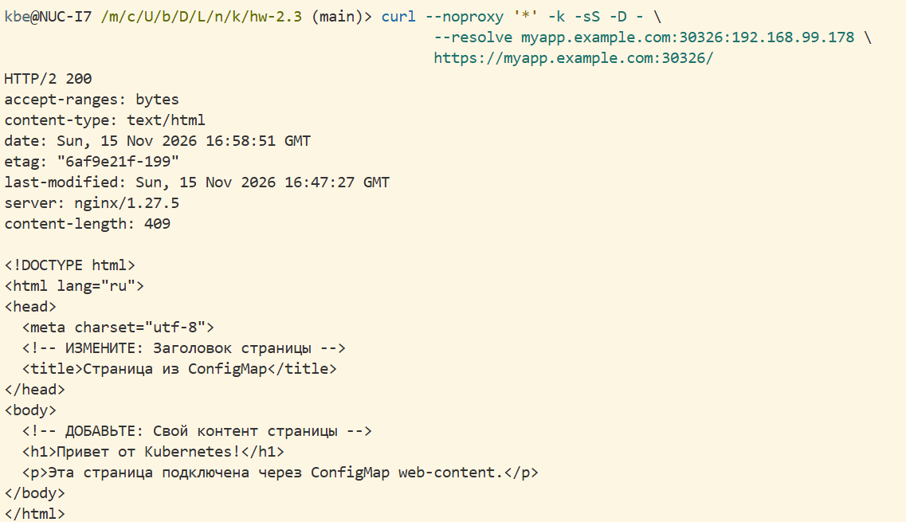
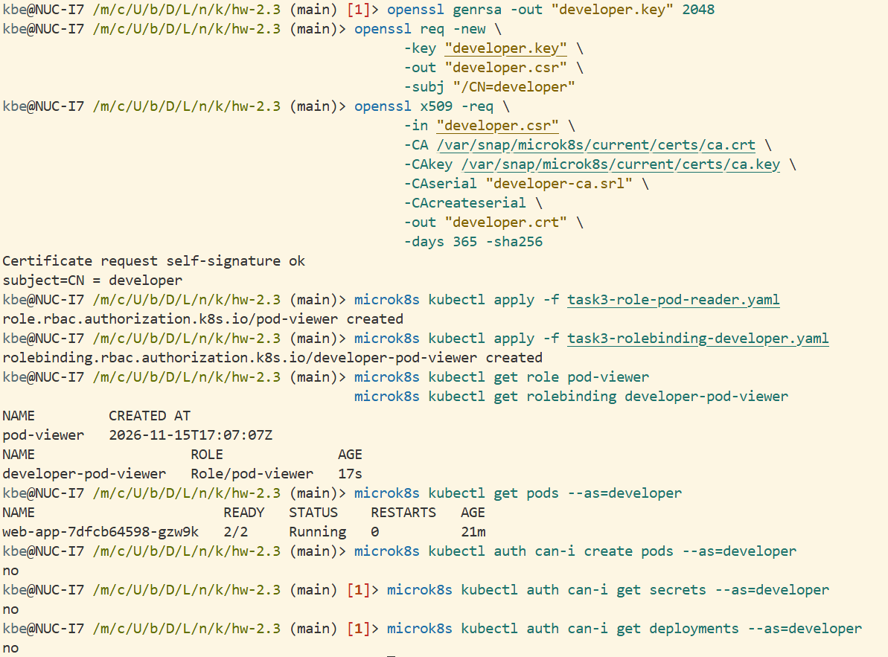

# Kubernetes: ConfigMap, Secret и RBAC

## Задание 1. Работа с ConfigMaps

**Создание приложения и проверка страницы из ConfigMap**



### 1.1. Deployment с nginx и multitool

Манифест: [task1-deployment.yaml](./task1-deployment.yaml). В файле также описан Service `web-app`.

### 1.3. Подключение веб-страницы через ConfigMap

Манифест: [task1-configmap-web.yaml](./task1-configmap-web.yaml).

### 1.4. Проверка доступности

Доступ к страниц проверен из multitool.

## Задание 2. Настройка HTTPS с Secrets

**Создание TLS Secret**



**Настройка Ingress с TLS**



**Проверка HTTPS-доступа**



### 2.1. Генерация SSL-сертификата

Команда создания самоподписанного сертификата:

```bash
openssl req -x509 -nodes -days 365 -newkey rsa:2048 \
  -keyout tls.key -out tls.crt -subj "/CN=myapp.example.com"
```

### 2.2. Secret

Манифест: [task2-secret-tls.yaml](./task2-secret-tls.yaml).

### 2.3. Ingress

Манифест: [task2-ingress-tls.yaml](./task2-ingress-tls.yaml).

### 2.4. Проверка HTTPS-доступа

Доступ к `myapp.example.com` проверен через curl.

## Задание 3. Настройка RBAC

**Сертификат пользователя и проверка прав developer**



### 3.1. Включение RBAC

В MicroK8s используется add-on `rbac`.

### 3.2. Создание сертификата пользователя

```bash
openssl genrsa -out developer.key 2048
openssl req -new -key developer.key -out developer.csr -subj "/CN=developer"
openssl x509 -req \
  -in developer.csr \
  -CA /var/snap/microk8s/current/certs/ca.crt \
  -CAkey /var/snap/microk8s/current/certs/ca.key \
  -CAserial developer-ca.srl -CAcreateserial \
  -out developer.crt -days 365 -sha256
```

### 3.3. Role и RoleBinding

- Role: [task3-role-pod-reader.yaml](./task3-role-pod-reader.yaml);
- RoleBinding: [task3-rolebinding-developer.yaml](./task3-rolebinding-developer.yaml).

Role разрешает чтение Pod и их логов в namespace `default`.
